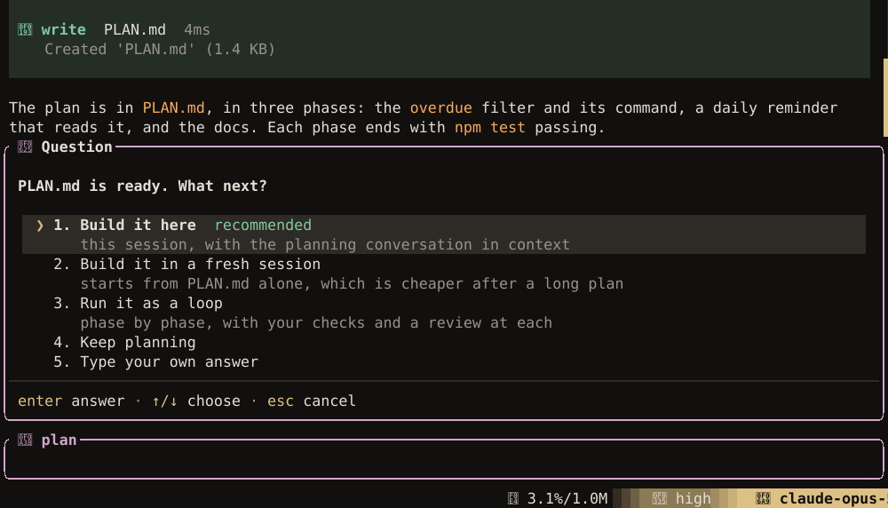

`luxe loop` runs the agent on its own, phase by phase through your plan. A phase only counts as done
once your tests pass and, if you set one up, a reviewer agrees.

## Write the plan

Put the plan in `PLAN.md` at the project root, one heading per phase.
[Plan mode](agent.md#plan-then-build) writes it in this shape for you, and when it is done, **Run
it as a loop** switches the session to build and tells you to run `luxe loop start`.



```markdown title="PLAN.md"
# Word counts

## Phase 0 — Count words
Read a file and print its word count. Tests for an empty file and one line.

## Phase 1 — Count by line
...
```

The agent is given one phase at a time, and the reviewer judges it against the same section. A plan
without phase headings is worked on as a whole.

## Start a run

```bash
luxe loop start
```

| Command | Does |
| --- | --- |
| `luxe loop start` | Start a run in a new session, at the phase the last one reached |
| `luxe loop status` | Iteration, phase, whether it is running, and what it has cost |
| `luxe loop pause`, `luxe loop resume` | Pause, and clear a pause so `start` continues |
| `luxe loop stop` | Stop the run |
| `luxe loop phase` | Show the phase. `--set <n>` changes it. |
| `luxe loop fresh` | Reset the turn count, so the next `start` gets all of `--max-turns` again |

| Flag | Default | Does |
| --- | --- | --- |
| `--max-turns` | `50` | Most turns before the run stops. The count carries over when you start again; `luxe loop fresh` resets it. |
| `--compact-percent` | the `compaction.at` you set, else `75` | How full the usable context window gets before the session is summarized; see [Compaction](sessions.md#compaction) |
| `--pause-percent` | `90` | How full it gets before the run stops. Keep it above `--compact-percent`, and run `luxe loop start` to go on. |
| `--quiet` | | Print only the banner |

A run uses your session's model, or `--model`. Only one run at a time works in a project.

## Check each phase

When the agent says a phase is done, Luxe checks it before moving on:

1. **Your commands.** Each must pass.
2. **A reviewer**, if `gate.review` is on and the commands passed. It runs in a fresh session, so
   it judges the phase without the reasoning that produced it. It reads the phase's section of the
   plan, the diff and the command output, and can look around the code with read-only tools. It
   cannot edit.

```json title=".luxe/config.json"
{
  "gate": {
    "commands": [
      ["cargo", "nextest", "run", "--workspace"],
      ["cargo", "clippy", "--workspace", "--all-targets", "--", "-D", "warnings"]
    ],
    "timeout_secs": 600,
    "review": true
  }
}
```

The reviewer runs on the run's own model unless `reviewer.model` names another, which turns
`gate.review` on by itself. A local model building and a hosted one reviewing is a common pairing:
the review is a few calls per phase, the building is most of them. See
[A second opinion](agent.md#a-second-opinion).

Each command is a program and its arguments, run without a shell. For shell features, use
`["sh", "-c", "…"]`. A project's commands replace your global ones only when you start with
`--trust-project`. Otherwise they're ignored with a warning, and your global commands apply.

If a check fails, the findings go back to the agent as work and the phase does not advance. With
neither check set up, the agent's word is taken. The same checks apply before the run may finish.

A review is limited to 24 tool calls and 10 minutes. A phase only advances when the reviewer
approves it. If the reviewer cannot answer, has nothing to read, or refuses the same phase three
times, the loop pauses for you: fix what it needs and run `luxe loop start` again, or accept the
phase with `luxe loop phase --set <next>`.

## Watch a run

A run prints one line per step, timed from its start:

```text
      19s    write logstats.py
      49s    test python3 -m unittest -q
    1m09s  phase 0 claimed complete — running the gate
    1m31s  the acceptance commands passed — asking the reviewer
    2m34s  phase 0 accepted — now on phase 1
```

`luxe loop status` shows what it has cost, by model:

```text
  Spend this run:
    claude-sonnet-5: 3 calls, 26295 tokens
    qwen3.6-27b: 19 calls, 188660 tokens
```

The conversation is in `.luxe/sessions/`, the log in `.luxe/logs/luxe.log`, and the journal the
agent keeps in `.luxe/loop/PROGRESS.md`. Past 24 KB, the journal's older `##` sections move to
`PROGRESS.archive.md` beside it, and a line pointing there takes their place. The newest section
stays, unless it is the only one.

## When a tool asks permission

Nobody is there to answer, so a tool call that would ask you is allowed by default. To refuse those
calls instead, and tell the agent to find another way:

```json title="~/.config/luxe/config.json"
{ "agent": { "on_ask": "deny" } }
```

`--on-ask deny` does the same for one run. A project can set `deny` but not `allow`. Calls your
permission rules deny are refused either way. See [Security](security.md#when-you-step-away).
