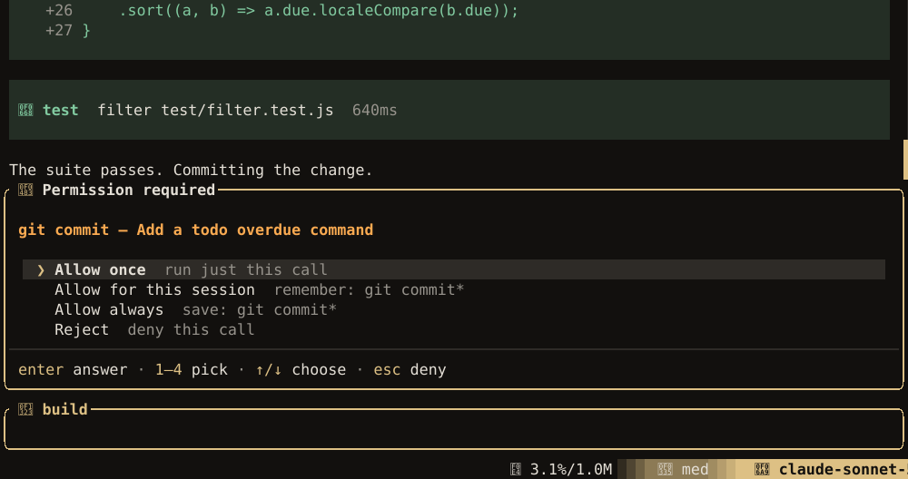

The agent reads and writes files and runs commands on your machine. Luxe lets ordinary work through
without asking, keeps a few guardrails on at all times, and gives you rules to tighten the rest.
For real isolation, run it in a [container](#isolation).

## What is allowed by default

Every tool call is **allowed**, **asked** about, or **denied**. With no configuration:

| | |
| --- | --- |
| **Denied** | Reading `.env` and `.env.*` files (`.env.example` is fine). Catastrophic commands: wiping `/`, your home folder or a system folder, `mkfs`, `dd` to a device, fork bombs. Running a command as root; see [below](#commands-that-need-root). The same call with the same arguments a third time in a row: the agent is told it already has the result. |
| **Asked** | Anything outside the project folder. `git push --force`. Committing. Writes to GitHub: opening, merging or commenting on pull requests and issues, and re-running CI. Capturing your screen. |
| **Allowed** | Everything else |

Commands are matched piece by piece, so `cd /tmp && rm -rf /` is caught. These are guardrails, not
a security boundary: a model set on getting around a pattern can. Committing asks because a commit
moves what Guided Review compares against; answer **Allow always** once and it stops asking.

Recursive `rm` has its own check, covering `-r`, `-R`, combined flags, `--recursive` and an
end-of-options `--`. It catches `/`, `/*`, whole-home targets such as `~`, `$HOME` and `${HOME}`,
and protected system folders and their contents. Ordinary build-folder cleanup stays allowed.
`/etc-backup/` isn't `/etc`, so its name alone doesn't trigger this guard.
A Bash allowance or session approval cannot waive this check; `--yolo` disables the default guard.

## Permission modes

```bash
luxe --permission-mode strict
```

| Mode | |
| --- | --- |
| `default` | The defaults above |
| `strict` | Ask before every change: `write`, `edit`, `bash`, `git`, `debug`, a `test` with its own `command`, and an applied `ast_grep` or `lsp_navigation` change |
| `read-only` | Deny every change, and a `test` with its own `command`. Reading, search, code intelligence and detected tests still work. Also `--read-only`. |
| `yolo` | Allow everything, guardrails off. Also `--yolo`. Your own `deny` rules still apply. |

[Plan mode](agent.md#plan-then-build) is a different thing: the session's mode, not a permission
mode. It refuses every change but a write to the plan file, before the permission rules are asked,
so a rule that allows a command does not let plan mode run it. A [review](agent.md#a-second-opinion)
runs in a mode that refuses every change.

## Rules

```json title="~/.config/luxe/permissions.json"
{
  "mode": "default",
  "permission": {
    "bash": { "*": "allow", "rm *": "ask", "git push * --force *": "deny" },
    "git": { "commit*": "allow" },
    "read": { "*": "allow", "*.env": "deny", "*.env.example": "allow" },
    "external_directory": { "~/scratch/**": "allow" },
    "mcp": { "github/*": "ask" }
  }
}
```

- **Keys** are tool names (`bash`, `read`, `edit`, which also covers `write`, `glob`, `grep`, `git`,
  `webfetch`, `websearch`, `screenshot`, `mcp`), plus `external_directory` for paths outside the
  project, `doom_loop` for repeated calls, and `hook_ask` for [hooks](hooks.md) that ask.
- **Values** are `allow`, `ask` or `deny`, or a map from pattern to one of them.
- **Patterns**: `*` matches anything, `?` one character, and `~` your home folder. `git *` also
  matches `git` alone. A `bash` pattern matches the command; a `read` or `edit` pattern, the path;
  an `mcp` pattern, `server/tool`.
- **The most specific pattern wins.**

Bash chains are also checked segment by segment. An allowance for `git *` does not allow
`git status && curl example.com`: the `curl` segment needs its own allowance. A denied segment
blocks the call. Otherwise, if any segment asks, the call asks too. Every segment must be allowed
for the whole chain to run without asking. The matcher is best-effort, not a shell parser.

Tools that run a program, change files or search a folder are judged by the same rules:

| Tool | Also checked as |
| --- | --- |
| `test` with a `command` | `bash`, segment by segment, with its `filter`; a filter that hides a second command is checked too |
| `debug` `launch` | `bash`, as the program and its arguments; a shell's `-c` script is checked as a command of its own |
| `ast_grep` replace with `apply: true` | `edit`, for each path |
| `lsp_navigation` rename or code action with `apply: true` | `edit`, for the file |
| `grep`, `glob`, `ast_grep` | `read`, for the folder or file searched |
| `module_report`, `read_symbol`, `lsp_navigation`, `lsp_diagnostics` | `read`, for each file opened |

Each tool's own rules still apply alongside. A folder outside the project asks, and a named `.env`
is denied even with `all: true`. **Always** on these prompts remembers only what was asked: the
exact command for `test` and `debug`, the folder for one search outside the project, and nothing
for an applied change, since its files aren't known until it runs.

`grep` and `ast_grep` also check every file they find before reading it, so a search of the whole
project skips a nested `.env`; `glob` checks every name before listing it. A file your rules deny is
skipped. One that would ask is read when the run approves asks on its own (headless by default, or
with auto-approve on) and skipped otherwise, since a search can't stop to ask. The result says how
many were skipped; `read` the file to be asked. A walk over a huge tree stops at 100,000 files and
says so.

An applied rename or code action is refused whole if the language server's edit names a file
outside the project or inside a fetched repository. These checks cover what a tool is asked to
open. They don't sandbox a language server, which can index other files and runs the project's own
code.

A project's `.luxe/permissions.json` can only make your rules stricter, never looser, unless you
start Luxe with `--trust-project`.

## The permission prompt

When a call needs approval, a prompt opens above the composer:



| Choice | Does |
| --- | --- |
| **Allow once** | Run this call |
| **Allow for this session** | Allow calls like it until you quit |
| **Allow always** | Write the rule to your `~/.config/luxe/permissions.json` |
| **Reject** | Refuse; the agent is told and carries on |

The prompt shows the rule an **Allow always** would write: a command family, such as `cargo *`, or
the whole folder for a path outside the project. A hook's prompt or a chained Bash command offers
only **Allow once** and **Reject**: one command family cannot cover a chain. Choose with the
arrows and `enter`, or a number; `esc` rejects. For a moment after it opens, the prompt ignores
every key but `esc`, so typing meant for the composer cannot answer it.

## When you step away

**Auto-approve** (`/permissions on`, or `--auto-approve`) allows every call that would ask, while
your `deny` rules still hold. The statusline says `auto-approve` for as long as it is on.

**A run with nobody to answer**, such as `--headless`, `luxe loop` or a phase reviewer, allows
every `ask` by default. To refuse them instead, and tell the agent why:

```bash
luxe --headless --on-ask deny -p "…"
```

or `"agent": { "on_ask": "deny" }` in `config.json`. A project can set `deny` but not `allow`.

**Four GitHub actions need a person**: merging a pull request, closing one, submitting a review, and
closing an issue. Auto-approve and unattended runs refuse them. To let an unattended run do one,
allow it in your own rules, such as `"bash": { "gh pr merge *": "allow" }`.

## Secrets

- Credentials are stored in `~/.config/luxe/auth.json`, readable only by you. Luxe warns if
  `auth.json` or `models.json` can be read by others.
- A key is found in this order: `--api-key` or `LUXE_API_KEY`, then what you signed in with, then
  the provider's own variable, then a provider block in `auth.json` or `models.json`. For a provider
  Luxe does not know, the block comes before `OPENAI_API_KEY`. The order is the same for the
  provider a session starts on and for one you switch to in `/model`.
- A key can be `$VAR` or `!command` rather than the value, so it never sits in a file. A command
  runs when a key is needed, so treat these files like your shell's startup file. It runs from your
  home folder and is stopped after 30 seconds, so a password manager that asks for a passphrase
  needs a graphical prompt.
- Anything that looks like a secret (API keys, tokens, private keys, passwords in URLs) is removed
  from tool output before the model, the transcript, hooks or the log see it. So is every key and
  token Luxe itself has used or loaded, whatever it looks like, including `$VAR` and `!command`
  keys and MCP tokens, as long as it is at least 8 characters.
- MCP sign-in tokens are kept in `~/.local/state/luxe/mcp-auth.json`, outside your config folder,
  so a dotfiles repository never carries them.
- An MCP server's `auth` token or OAuth sign-in only travels over `https`, or plain `http` to
  this machine; a server or sign-in endpoint elsewhere on plain `http` is refused. A key you put in
  a server's `headers` is not checked, so use `https` for one. See [MCP](mcp.md#sign-in).
- Anthropic and Google take API keys only, since their terms do not allow their subscriptions in
  other programs.

## Commands that need root

The agent does not run commands as root: `sudo`, `doas`, `su`, `pkexec`, `run0`, and `gsudo` or
`runas` on Windows. A command that needs root needs your attention and consent, and typing it into
your own terminal is how you give both. So when a step needs one, the agent puts the exact command
in a code block, you copy it into another terminal and run it, then tell the agent it is done.

The same goes for a command that waits on you at a terminal, such as a password, a confirmation or
an interactive installer. Commands the agent runs have no terminal at all, so one of those fails at
once and says what it wanted, rather than waiting where nobody can answer.

To allow it anyway, decide ahead of time in your global file. It only helps where no password is
needed, such as a passwordless `sudo` rule for one program:

```json title="~/.config/luxe/permissions.json"
{ "permission": { "bash": { "sudo pacman *": "allow" } } }
```

`--yolo` allows it too. A project's `.luxe/permissions.json` cannot.

## Screen capture

The `screenshot` tool's `url` mode renders a web page and captures only that. Its `fullscreen`,
`region` and `window` modes capture whatever is on your screen, and the image goes to your model
provider, so each **asks** first, and runs with nobody watching refuse them. To turn screen capture
off entirely:

```json title="~/.config/luxe/permissions.json"
{ "permission": { "screenshot": { "fullscreen": "deny", "region": "deny", "window": "deny" } } }
```

## Untrusted repositories

Opening a repository should not run its code. So, without `--trust-project`:

- Its `.luxe/hooks.json` is ignored.
- Its `gate.commands` in `.luxe/config.json` are ignored with a warning. The loop uses your global
  commands instead; a project list needs `--trust-project`.
- Its `.luxe/permissions.json` can only tighten your rules.
- Its MCP servers, language servers and formatters start only in an interactive session; see
  [Tools](tools.md#a-server-the-project-installed).

Its `AGENTS.md` and skills, including the ones it commits in `.agents/skills/`, still reach the
model, because your own project's are the point of the feature. Luxe removes text a reviewer
cannot see, comments and invisible Unicode, and leaves out a file it cannot finish checking; see
[What Luxe removes](project-context.md#what-luxe-removes). Plain text is still instructions, so read
an unfamiliar repository's `AGENTS.md` as you would its `Makefile`.
Text from GitHub, such as issues and comments, is filtered the same way and given to the agent as
someone else's words, not as instructions. So are MCP servers' descriptions and results.

A language server can run project code itself: rust-analyzer runs `build.rs`. Treat opening a
repository in Luxe like building it.

A repository the agent fetches with `web_fetch` is different: you never chose to open it. Luxe
clones it into `.luxe/gh-cache/` with symbolic links flattened to plain files, and starts no
language server or formatter there; see [Tools](tools.md#github-repositories).

### Isolation

Rules are a policy, not a sandbox. For hard isolation, run Luxe in a container that mounts only the
project:

```bash
docker run --rm -it -v "$PWD":/work -w /work -e ANTHROPIC_API_KEY <image-with-luxe> \
  luxe --headless -p "…"
```

Do not mount your home folder or SSH keys. `--network none` works for everything but the model
provider, the web tools, the catalog refresh and the update check.

## What Luxe sends over the network

There is no telemetry. Luxe connects only to:

1. The model provider you configured, including the cache refreshes described in
   [Keeping the cache warm](sessions.md#keeping-the-cache-warm) (`"agent": { "cache_warming": "off" }`
   stops them). For GitHub Copilot that includes reading your plan's usage from GitHub every few
   minutes while you work (`LUXE_COPILOT_PLAN_USAGE=0` stops it). For an Azure resource it includes
   listing what the resource has deployed when you open `/model` (`"discover_deployments": false`
   on the provider stops it)
2. Search providers and web pages, when the agent uses `web_search` or `web_fetch`, and GitHub
   when `web_fetch` clones a repository (`"tools": { "clone_repositories": false }` stops it)
3. The models.dev catalog, to refresh model details (`LUXE_MODELS_DEV_REFRESH=0` stops it)
4. The update check, once a day (`"update": { "check": false }` stops it)
5. GitHub, through your own `gh`, when you, the agent or an [RPC client](rpc.md#github-writes) work
   with pull requests and issues. A client can write there only if you start it with
   `--github-writes`.

None of them carries anything about you or your machine. The update check sends no version,
platform or identifier; it downloads a public file and compares versions locally.

One local report stays on your machine: inside a [herdr](configuration.md#herdr) pane, Luxe runs
herdr's own command to tell it whether the agent is working, idle or waiting on you, and the id of
the session for herdr to resume. Nothing is sent outside herdr, and `"herdr": false` stops it.

What you post to GitHub is yours alone: reviews, replies and pull requests are posted from a
preview, with nothing added, and no agent tool can post them.

## Supply chain

Luxe is written in Rust with `unsafe` code denied throughout, apart from two reviewed blocks in what
ships: one starts each command in a session of its own, so nothing the agent runs can reach your
terminal, and one on Windows keeps the programs Luxe starts off the stdin `--rpc` reads. CI checks
every dependency's security advisories and license with `cargo-deny`, builds with `--locked`, and
pins its GitHub Actions to exact commits.
