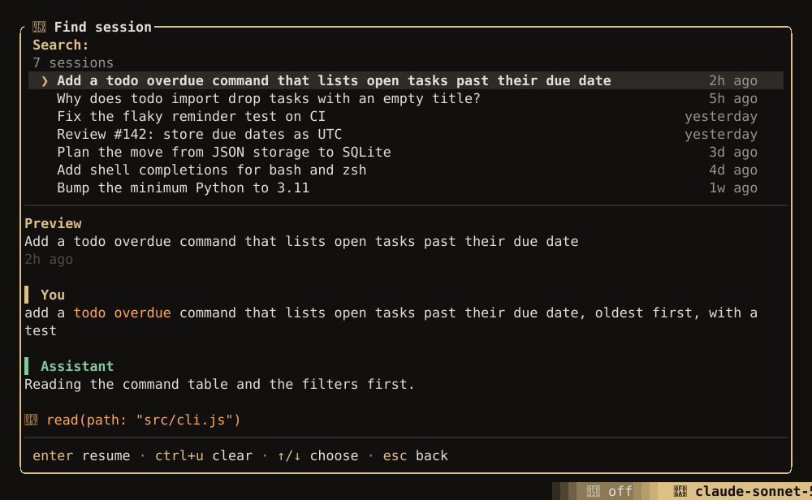

## Sessions

Every conversation is saved as it goes, in `.luxe/sessions/` inside the project. Quitting loses
nothing.

| To | In Luxe | From the command line |
| --- | --- | --- |
| Pick up the last session | **Resume** on the start screen | `luxe -c` |
| Find an older one | Type part of its title on the start screen, or open **Sessions…** (`/sessions`) | `luxe sessions list`, then `luxe --resume <id>` |
| Return to the session that worked on a pull request | type `#146` in **Sessions…** | `luxe --from-pr 146` |
| Start fresh | `/new`, or type on the start screen and press `enter` | `luxe` |



**Sessions…** searches session titles and what was said in them, with a preview of the one under
the cursor. `/sessions` opens it from the start screen or from inside a session. However you resume a
session, it runs in its own worktree when it has one, and keeps what you had typed and the mode,
model and thinking level you chose. `/new` keeps the session you leave, so you can come back to it.

## Cost

The dock's **SESSION** section shows context used, tokens and cost as you go. `/cost` shows the
session's cost with the tokens behind it, how much of the input was read from the provider's cache,
and, once more than one of them has spent something, the split between `agent`, `review`,
`compaction` and `cache warming`. On a ChatGPT or
Copilot plan, it shows what the usage would have cost at API prices, and what is left of the plan's
allowance when the provider reports it. A model that charges more for a long prompt, as models.dev
lists for some Claude and Gemini models, is priced at the higher rate for each request past the
threshold. A price you set in `models.json` replaces the catalog's, tiers and all.

### Keeping the cache warm

Anthropic keeps a cached prompt for five minutes after it was last read. A turn that waits longer
than that, on a slow command, a permission prompt or a question, loses the cache, and the next
request pays to write the whole conversation again: about $2 on a 400k-token Opus session. So while
a turn runs, Luxe re-sends its last request with a one-token reply just before the five minutes are
up. That costs a cache read, a tenth of the write it saves.

`agent.cache_warming` decides when:

| Value | Keeps the cache warm |
| --- | --- |
| `streaming` (default) | While a turn is running |
| `idle` | While a turn is running, and for up to 30 minutes after it |
| `off` | Never |

A refresh goes out only when it is expected to save at least $0.05, so a short conversation is
never refreshed. Between turns Luxe cannot know you will reply, so `idle` refreshes only a large
conversation. On real sessions it lost money overall, which is why it is not the default. Refreshes
are never sent on a subscription plan, or for an Anthropic model using a fixed thinking budget,
whose cache would change on replay. Their cost shows under **cache warming** in `/cost`.

The other answer to a long pause is `supports_long_cache_retention`, which asks Anthropic to keep
the cache for an hour; see [Custom providers](custom-providers.md#request-format). It costs
more on every turn instead of on each pause.

## The context window

`/context` shows what fills the context window, largest first:

```text
 GPT-5.6 Sol   18.5k of 1.1M · 2% used

  conversation     9.6k   52%
      `read` crat…-tui/src/statusline.rs   9.2k
  tool schemas     4.5k   25%
  instructions     2.8k   15%
  harness          1.5k    8%
  free             1.0M
```

| Row | Is | Shrink it with |
| --- | --- | --- |
| conversation | Messages, tool calls and results, reasoning, images | `/compact`, `/new` |
| tool schemas | The tools the agent can call | `tools.disabled`; see [Tools](tools.md) |
| instructions | Your `AGENTS.md` files | A shorter file; see [Project context](project-context.md) |
| skills | The list of skills the agent can load | Fewer, or shorter descriptions |
| harness | Luxe's own instructions | Nothing; this is fixed |
| appended | One-time context added to a resumed session, such as what changed while you were away | `/new` |

The largest single items are named under a row, which is usually how you find a `read` or `bash`
call that should have been narrower. The total is what the provider reported for the last request.

## Compaction

When a conversation fills 90% of the usable window, Luxe summarizes it and carries on, keeping the
most recent part word for word. The summary records the goal, constraints, progress, decisions,
next steps and the files the session touched. You see a line like
`Compacted the conversation — 82k → 21k of context.`

`/compact` summarizes now. Add what matters to steer the summary: `/compact the API decisions`. A
conversation that already fits in what `keep_recent` keeps has nothing to summarize, and `/compact`
says so.

Before summarizing, from 80% full, Luxe first replaces old tool output in the request with a short
placeholder. The session file keeps everything; only what is sent changes.

To change when and how it happens:

```json title="~/.config/luxe/config.json"
{
  "compaction": {
    "auto": true,
    "at": 0.9,
    "keep_recent": 20000,
    "reserve": 20000,
    "prune": true,
    "summarizer": "anthropic/claude-haiku-4-5"
  }
}
```

| Key | Default | Does |
| --- | --- | --- |
| `auto` | `true` | Summarize automatically. Off leaves it to `/compact` and turns pruning off too; a request the provider refuses as too long is still summarized and sent again, once. |
| `at` | `0.9` | How full the usable window gets before summarizing. Pruning starts 0.1 earlier. |
| `keep_recent` | `20000` | Tokens of the newest conversation kept word for word |
| `reserve` | `20000` | Most tokens held back for the reply when judging how full the window is, or the model's output limit if that is smaller |
| `prune` | `true` | Replace old tool output before summarizing |
| `summarizer` | the session's model | The model that writes the summary, as `provider/id`, on a provider you have set up. A smaller, cheaper model is usually enough, and `/cost` prices its spend as it does any other model's. |

This works in a project's `.luxe/config.json` too, and so does `agent.cache_warming`, which a project
can turn down but not up. The compaction settings in `/settings` apply the next time Luxe starts.

## Long command output

Build, test and lint output is trimmed before the agent sees it. Errors, warnings, failing tests,
`file:line` locations and exit codes are always kept; progress bars, color codes and repeated lines
are not. When output is trimmed, the untouched text is saved under `.luxe/artifacts/` (each stream
whole up to 8 MB, or its first and last 4 MB past that) and its path is included, so the agent can
read it if it needs to. Set `LUXE_COMPRESS=0` to turn this off; output past the size limit is still
cut and saved.

Searches and listings (`grep`, `glob`, `git log`) are capped the same way, with a note saying how
many more results there are.
